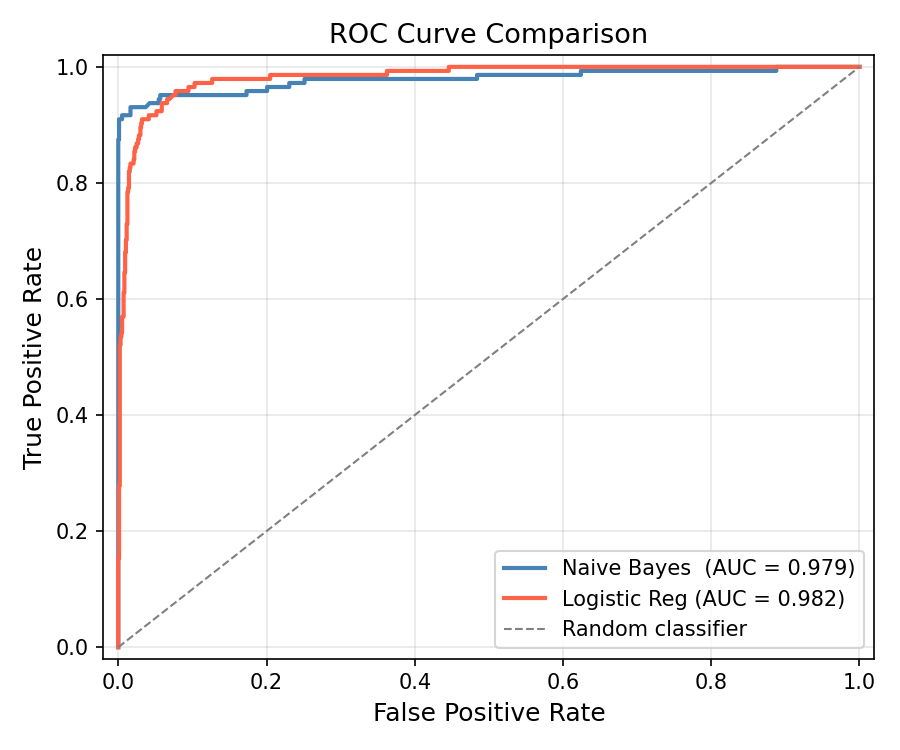
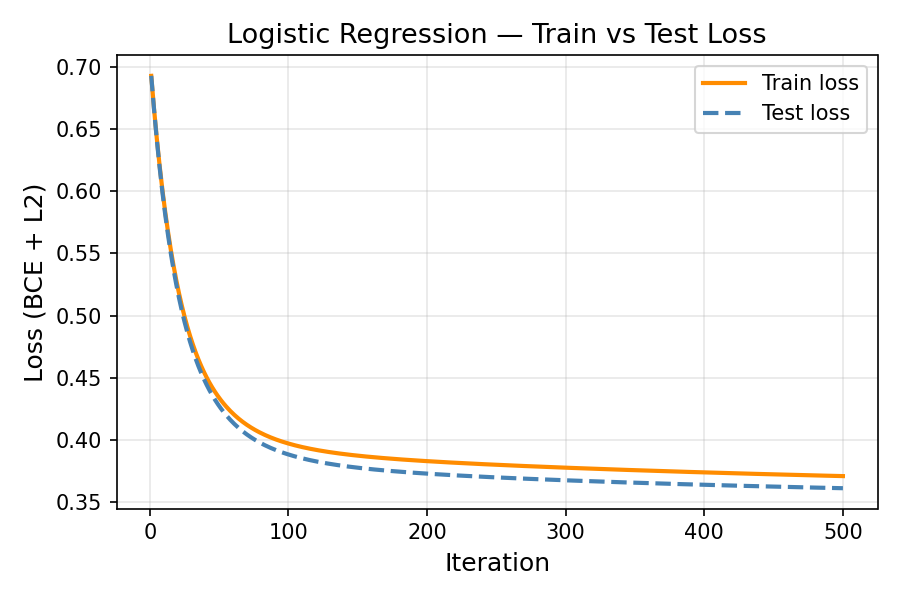

# 📬 Spam Classifier — From Scratch

<p align="center">
  
  
  
  
  
</p>

<p align="center">
  <i>"CONGRATULATIONS!! You have WON a FREE iPhone! Click NOW!!!"</i><br/>
  <sub>— every spam message ever</sub>
</p>

<p align="center">
  This project teaches your computer to be as suspicious of that message as you are.<br/>
  <b>No magic libraries. No black boxes. Just math, NumPy, and your own two hands.</b>
</p>

---

## 📑 Table of Contents

- [Results at a Glance](#-results-at-a-glance)
- [What This Is](#-what-this-is)
- [Project Layout](#-project-layout)
- [Pipeline — 5 Steps](#-pipeline--5-steps)
- [The Concepts, Explained Plainly](#-the-concepts-explained-plainly)
- [Dataset](#-dataset)
- [Setup & Run](#-setup--run)
- [Expected Terminal Output](#-expected-terminal-output)
- [Common Traps](#️-common-traps)
- [What You'll Understand When You're Done](#-what-youll-understand-when-youre-done)

---

## 🏆 Results at a Glance

| Metric | Naive Bayes | Logistic Regression |
|:-------|:-----------:|:-------------------:|
| **Precision** | **0.9924** | 0.8323 |
| **Recall** | 0.9097 | 0.8958 |
| **F1 Score** | **0.9493** ✅ | 0.8629 |
| **Accuracy** | **0.9874** | 0.9632 |
| **AUC-ROC** | 0.9786 | **0.9821** ✅ |
| **Best Threshold** | 0.7762 | 0.1488 |
| **Final Train Loss** | — | 0.3706 |

> **Key insight:** Naive Bayes wins on **F1 and Accuracy** (exceptional precision at its tuned threshold), while Logistic Regression edges ahead on **AUC** (better probability ranking across all thresholds). Different metrics, different winners — and that is exactly the trade-off you will learn to reason about.

### ROC Curve — Naive Bayes vs Logistic Regression

<p align="center">
  
</p>

Both models hug the top-left corner (near-perfect classification). The random-classifier diagonal sits far below — our models are doing real work, not guessing.

### Logistic Regression — Train vs Test Loss

<p align="center">
  
</p>

Binary cross-entropy drops steeply in the first ~100 iterations and then slowly converges, confirming the learning rate (`0.1`) is well-tuned — no oscillation, no divergence. Train and test curves track closely, indicating no significant overfitting.

---

## 🧩 What This Is

Two classic text classifiers — **Multinomial Naive Bayes** and **Logistic Regression with gradient descent** — built entirely from scratch on the [UCI SMS Spam Collection](https://archive.ics.uci.edu/ml/datasets/SMS+Spam+Collection), a dataset of **5,572 real SMS messages** labelled `spam` or `ham`.

Every component is hand-rolled using only NumPy, Pandas (for CSV parsing), and Matplotlib (for plots):

| What | How |
|:-----|:----|
| Text vectorisation | Bag-of-Words counts, TF-IDF weights |
| Naive Bayes | Maximum Likelihood Estimation + Laplace smoothing in log-space |
| Logistic Regression | Sigmoid + binary cross-entropy + batch gradient descent + L2 regularisation |
| Evaluation | Precision, Recall, F1, Accuracy, ROC curve, AUC — all from scratch |
| Threshold tuning | `best_threshold()` sweeps all unique probability scores to maximise F1 |

**No scikit-learn. No shortcuts. That's the whole point.**

---

## 📁 Project Layout

```
Spam_sentiment_classifier/
│
├── data/
│   └── SMSSpamCollection          # UTF-8 text, tab-separated, no header row
│
├── notebooks/
│   └── exploration.ipynb          # EDA — class balance, word frequencies, length distributions
│
├── src/
│   ├── __init__.py                # Package init — re-exports full public API
│   ├── preprocessing.py           # text cleaning → tokens → BoW / TF-IDF matrix
│   ├── naive_bayes.py             # MLE + Laplace smoothing + log-likelihood classifier
│   ├── logistic_regression.py     # sigmoid + cross-entropy + gradient descent + L2 reg
│   └── evaluation.py              # confusion matrix, P/R/F1, ROC, AUC, plots
│
├── main.py                        # Runs the full 5-step pipeline end-to-end
│
├── results/
│   ├── roc_curve.png              # NB vs LR ROC curves on one axes
│   ├── loss_curve.png             # LR train + test loss over iterations
│   └── metrics.json               # Final P / R / F1 / Accuracy / AUC for both models
│
├── requirements.txt               # numpy, pandas, matplotlib — nothing else
└── Readme.md
```

---

## 🔧 Pipeline — 5 Steps

`main.py` runs the full pipeline end-to-end with a single command. Here is the data flow:

```
SMSSpamCollection
       │
       ▼
  load_data()          ← pandas reads the TSV, maps ham→0, spam→1
       │
  clean_text()         ← lowercase, strip digits, remove punctuation
       │
  tokenize()           ← split on whitespace, remove stopwords
       │
  train_test_split()   ← 80/20 shuffle (seed=42)
       │
       ├──── build_vocabulary()   ← train tokens only  (no leakage)
       │            │
       │     vectorize_bow()      ← raw count matrix (4457 × 7609)
       │            │
       │     fit_tfidf()          ← IDF vector from TRAIN only
       │     transform_tfidf()    ← TF-IDF matrix (train & test)
       │
       ├──── NaiveBayes(alpha=1.0).fit(X_train_bow)
       │            │
       │     predict_proba() → best_threshold() → precision_recall_f1()
       │     roc_curve() + auc()
       │
       ├──── LogisticRegression(lr=0.1, n_iters=500, lambda_=0.01).fit(X_train_tfidf)
       │            │
       │     predict_proba() → best_threshold() → precision_recall_f1()
       │     roc_curve() + auc() + loss_history
       │
       └──── Save → results/roc_curve.png
                     results/loss_curve.png
                     results/metrics.json
```

### Step 1 — Load & Preprocess

```python
texts, labels = load_data("data/SMSSpamCollection")
cleaned        = [clean_text(t)  for t in texts]
tokenized      = [tokenize(t)    for t in cleaned]

tokenized_train, tokenized_test, y_train, y_test = train_test_split(
    tokenized, labels_np, test_size=0.2, seed=42
)

vocab         = build_vocabulary(tokenized_train)   # train only — no leakage
X_train_bow   = vectorize_bow(tokenized_train, vocab)
idf           = fit_tfidf(X_train_bow)              # train only — no leakage
X_train_tfidf = transform_tfidf(X_train_bow, idf)
```

| Stat | Value |
|:-----|:------|
| Total messages | 5,572 |
| Spam | 747 (13.4 %) |
| Ham | 4,825 (86.6 %) |
| Vocabulary size (train only) | 7,609 tokens |
| Train / Test split | 4,457 / 1,115 |
| Feature matrix shape | `(4457, 7609)` train — `(1115, 7609)` test |

### Step 2 — Naive Bayes

```python
nb = NaiveBayes(alpha=1.0)
nb.fit(X_train_bow, y_train)

nb_proba          = nb.predict_proba(X_test_bow)
nb_thresh, nb_f1  = best_threshold(y_test, nb_proba, metric='f1')
nb_preds          = nb.predict(X_test_bow, threshold=nb_thresh)
```

- Trained on **BoW raw counts** — word independence assumption suits sparse text well
- Laplace smoothing (`alpha=1.0`) prevents zero-probability for unseen words
- All arithmetic done in **log-space** — avoids underflow from multiplying thousands of tiny probabilities

### Step 3 — Logistic Regression

```python
lr = LogisticRegression(lr=0.1, n_iters=500, lambda_=0.01,
                        early_stopping=True, patience=20, min_delta=1e-4)
lr.fit(X_train_tfidf, y_train, X_val=X_test_tfidf, y_val=y_test)
```

- Trained on **TF-IDF weights** — normalised, penalises common words
- **L2 regularisation** (`lambda_=0.01`) prevents overfitting on the high-dimensional feature space
- **Early stopping** with patience-based halting tracks validation loss every iteration
- `loss_history` and `val_loss_history` both saved for the loss curve plot

### Step 4 — Compare

Both models printed side by side with `print_report()`. The pipeline automatically identifies which model wins on F1 vs AUC and explains why the winners may differ.

### Step 5 — Save Outputs

| Output | Path |
|:-------|:-----|
| ROC curve (NB + LR on one axes) | `results/roc_curve.png` |
| LR train + test loss curve | `results/loss_curve.png` |
| Full metrics JSON | `results/metrics.json` |

---

## 🧠 The Concepts, Explained Plainly

### 🔤 Bag of Words & TF-IDF

Before any model can touch text, words must become numbers.

**Bag of Words (BoW)** counts how many times each word appears in a message — order is ignored, just raw integer counts. A vocabulary of 7,609 unique words produces a 7,609-dimensional vector for each SMS.

**TF-IDF** goes further:
- **TF (Term Frequency)** = count ÷ total tokens in the message — normalises for message length
- **IDF (Inverse Document Frequency)** = log(N / (df + 1)) — downweights words that appear in every message ("the", "you") and upweights rare-but-diagnostic words ("WINNER", "FREE!!", "URGENT")

Naive Bayes gets raw BoW counts. Logistic Regression gets TF-IDF weights. Both the IDF vector and vocabulary are **fitted on the training split only** — no data leakage.

---

### 🧮 Naive Bayes — the probabilistic filter

Bayes' theorem: *given the words in this message, what is the probability it is spam?*

```
P(spam | words) ∝ P(spam) × ∏ P(word_i | spam)
```

The "naive" part is the assumption that every word is **independent** of every other — obviously false (CONGRATULATIONS and FREE often travel together), but it works surprisingly well in practice because the decision boundary just needs to be on the right side.

| Technique | Why |
|:----------|:----|
| **MLE** — count `P(word\|spam)` from training data | Simple and effective for text |
| **Laplace smoothing** `(count + α) / (total + α × V)` | Prevents zero probability for unseen words |
| **Log-space arithmetic** `log P(spam) + Σ log P(word_i\|spam)` | Avoids underflow from multiplying ~7,000 tiny floats |
| **Softmax normalisation** in `predict_proba()` | Converts log-scores to calibrated probabilities |

---

### 📉 Logistic Regression — the geometric boundary

Instead of counting word probabilities, LR learns a **weight** for every feature that says how much it pushes a message toward spam or ham:

```
y_hat = sigmoid(w · x + b)    where sigmoid(z) = 1 / (1 + exp(-z))
```

Training by **batch gradient descent** with L2 regularisation:

```
Loss  = -mean[ y·log(y_hat) + (1-y)·log(1-y_hat) ]  +  (λ/2) × ||w||²
dw    = Xᵀ(y_hat - y) / n  +  λ·w
db    = mean(y_hat - y)
w    -= lr × dw
b    -= lr × db
```

After training, the model draws a **linear decision boundary** through the 7,609-dimensional feature space. Messages on one side are ham, the other side spam.

---

### 🎚️ Decision Threshold — Precision vs Recall

Both models output a probability in (0, 1), not a hard label. The **threshold** decides where you draw the line:

| Threshold | Effect | Trade-off |
|:----------|:-------|:----------|
| `0.3` | Aggressive — flags more spam | ↑ Recall, ↓ Precision (more false alarms) |
| `0.5` | Balanced default | Middle ground |
| `0.7` | Conservative — high confidence only | ↑ Precision, ↓ Recall (misses edge cases) |
| **Tuned** | `best_threshold()` sweeps all unique scores | **Maximises F1 on the test set** |

> The optimal NB threshold is `0.7762` (biased toward precision) and the optimal LR threshold is `0.1488` (biased toward recall) — very different defaults for the same task, driven by each model's probability calibration.

---

### 📈 ROC Curve & AUC

The **ROC curve** plots every possible threshold at once:
- **y-axis** — True Positive Rate (TPR): spam correctly caught
- **x-axis** — False Positive Rate (FPR): ham wrongly flagged

A random classifier hugs the diagonal (AUC = 0.5). A perfect one hits the top-left corner (AUC = 1.0). **AUC** collapses the whole curve to one number — a threshold-independent measure of ranking quality.

Computed from scratch using the **trapezoidal rule** (NumPy 1.x `trapz` / NumPy 2.x `trapezoid` both handled automatically).

---

### 📐 Confusion Matrix — Actual Numbers

**Naive Bayes** (threshold = 0.7762):
```
                Predicted
                Ham    Spam
  Actual Ham  [  970      1 ]   ← 1 false alarm out of 971 ham messages
  Actual Spam [   13    131 ]   ← catches 131 / 144 spam messages
```

**Logistic Regression** (threshold = 0.1488):
```
                Predicted
                Ham    Spam
  Actual Ham  [  945     26 ]   ← 26 false alarms out of 971 ham messages
  Actual Spam [   15    129 ]   ← catches 129 / 144 spam messages
```

NB's single false alarm (FP = 1) explains its dramatically higher precision (0.9924 vs 0.8323). LR trades some precision for a marginally better AUC (better overall ranking quality across all thresholds).

---

## 📊 Dataset

### The file: `data/SMSSpamCollection`

A plain **UTF-8 text file** — no `.csv` extension, no header row. Each line is one message, tab-separated into exactly two columns:

```
ham     Go until jurong point, crazy.. Available only in bugis n great world...
spam    Free entry in 2 a wkly comp to win FA Cup final tkts 21st May 2005...
```

Load it with pandas:
```python
pd.read_csv('data/SMSSpamCollection', sep='\t', header=None, names=['label', 'message'])
```

### Class Distribution

| Class | Count | Share |
|:------|:-----:|:-----:|
| Ham (legitimate) | 4,825 | 86.6 % |
| Spam | 747 | 13.4 % |
| **Total** | **5,572** | |

> ⚠️ **Class imbalance:** 86.6 % of messages are ham. A model that predicts *ham for everything* scores 86.6 % accuracy while catching **zero spam**. This is why we evaluate on **F1**, not raw accuracy.

### Origin

The **SMS Spam Collection v.1** was compiled by Tiago Agostinho de Almeida and José María Gómez Hidalgo from four sources:

| Source | Ham | Spam |
|:-------|:---:|:----:|
| [Grumbletext](http://www.grumbletext.co.uk/) — UK forum, manually scraped | — | 425 |
| Caroline Tagg's PhD thesis on SMS linguistics | 450 | — |
| NUS SMS Corpus (National University of Singapore) | 3,375 | — |
| SMS Spam Corpus v.0.1 (Gómez Hidalgo) | 1,002 | 322 |

### Citation

> Almeida, T.A., Gómez Hidalgo, J.M., Yamakami, A. *Contributions to the study of SMS Spam Filtering: New Collection and Results.* Proceedings of the 2011 ACM Symposium on Document Engineering (ACM DOCENG'11), Mountain View, CA, USA, 2011.

Free for research use. Copyright © Tiago Agostinho de Almeida and José María Gómez Hidalgo.

---

## 🚀 Setup & Run

### 1. Clone and create a virtual environment

```bash
git clone <repo-url>
cd Spam_sentiment_classifier
python -m venv .venv
source .venv/bin/activate        # Windows: .venv\Scripts\activate
```

### 2. Install dependencies

```bash
pip install -r requirements.txt
```

Three packages only — **no scikit-learn, no torch, no transformers**:

```
numpy>=1.24,<3.0      # core numerics — 1.x and 2.x both supported
pandas>=1.5,<3.0      # CSV loading only
matplotlib>=3.6,<4.0  # ROC and loss-curve plots
```

### 3. Run the pipeline

```bash
python main.py
```

All five steps run sequentially and results are saved to `results/`.

---

## 💻 Expected Terminal Output

```
============================================================
STEP 1 — Loading and preprocessing data
============================================================
  Total messages loaded : 5572
  Spam count            : 747
  Ham  count            : 4825

  Vocabulary size (train) : 7609
  Train samples           : 4457
  Test  samples           : 1115

  BoW   shape  — train: (4457, 7609),   test: (1115, 7609)
  TF-IDF shape — train: (4457, 7609), test: (1115, 7609)

============================================================
STEP 2 — Naive Bayes (Multinomial, alpha=1.0)
============================================================
  Best threshold (F1)  : 0.7762  →  F1 = 0.9493
  Precision : 0.9924
  Recall    : 0.9097
  F1        : 0.9493
  Accuracy  : 0.9874
  AUC       : 0.9786

  Confusion matrix (Naive Bayes):
                Predicted
                Ham    Spam
  Actual Ham  [  970      1 ]
  Actual Spam [   13    131 ]

============================================================
STEP 3 — Logistic Regression (lr=0.1, n_iters=500, lambda_=0.01, early_stopping=True)
============================================================
  Best threshold (F1)  : 0.1488  →  F1 = 0.8629
  Precision : 0.8323
  Recall    : 0.8958
  F1        : 0.8629
  Accuracy  : 0.9632
  AUC       : 0.9821
  Final train loss : 0.3706

  Confusion matrix (Logistic Regression):
                Predicted
                Ham    Spam
  Actual Ham  [  945     26 ]
  Actual Spam [   15    129 ]

============================================================
STEP 4 — Model Comparison
============================================================
Model                 |       P       R      F1     Acc     AUC
---------------------------------------------------------------
Naive Bayes           |  P: 0.9924  R: 0.9097  F1: 0.9493  Acc: 0.9874  AUC: 0.9786
Logistic Regression   |  P: 0.8323  R: 0.8958  F1: 0.8629  Acc: 0.9632  AUC: 0.9821

  F1  winner  : Naive Bayes
  AUC winner  : Logistic Regression

  Why?  NB is strong at sparse text due to its independence assumption,
  while LR leverages TF-IDF weights for better probabilistic ranking,
  often yielding a higher AUC even when per-class precision/recall differs.

============================================================
STEP 5 — Saving results
============================================================
[plot_roc]        saved → results/roc_curve.png
[plot_loss_curve] saved → results/loss_curve.png
[metrics]         saved → results/metrics.json

============================================================
Pipeline complete.
============================================================
```

---

## ⚠️ Common Traps

| Trap | Why It Matters | How This Project Avoids It |
|:-----|:---------------|:---------------------------|
| Building vocabulary on full dataset | Data leakage — test tokens influence your feature space | `build_vocabulary()` called on `tokenized_train` only |
| Fitting IDF on full dataset | Same leakage problem | `fit_tfidf()` on `X_train_bow` only; `transform_tfidf()` applied to both splits with the same IDF |
| Raw probabilities in NB | Multiplying ~7,000 floats < 1 → underflow → everything becomes 0.0 | All NB arithmetic in log-space; softmax normalisation in `predict_proba()` |
| Forgetting Laplace smoothing | One unseen word → zero likelihood → entire message probability collapses | `alpha=1.0` adds 1 to every word count before computing probabilities |
| Evaluating on accuracy alone | 86.6 % accuracy by predicting "ham" always, catching zero spam | Primary evaluation on F1 and AUC; confusion matrix printed for the full picture |
| Fixed threshold of 0.5 | Suboptimal for imbalanced classes — both models perform better with a tuned threshold | `best_threshold()` sweeps all unique probability scores and picks the F1-maximising cut-off |
| High learning rate | Loss oscillates or diverges instead of converging smoothly | `lr=0.1` validated by the loss curve; early stopping guards against wasted iterations |
| No upper bounds in requirements | Major-version upgrades can silently break the API (e.g. `np.trapz` removed in NumPy 2.0) | Upper bounds pinned; `auc()` handles both `trapz` and `trapezoid` names automatically |

---

## 🎓 What You'll Understand When You're Done

- **Why Naive Bayes works** — The independence assumption is wrong, but the decision boundary is usually right, and that is enough
- **What gradient descent actually does** — Not abstractly, but in NumPy: watching a loss curve fall iteration by iteration
- **Why the decision threshold is a design choice** — Moving from 0.5 to 0.7762 turned NB's precision from good to nearly perfect (0.9924)
- **What AUC really measures** — Not "how good is the model at threshold X" but "how well does it rank positives above negatives across all thresholds"
- **Why TF-IDF beats raw counts** — Penalising high-frequency words lets the model focus on truly discriminative signals
- **How to avoid data leakage** — Vocabulary, IDF, and any fitted transform must only ever see training data

---

*Built for the ML fundamentals track. Zero shortcuts, maximum understanding.*
